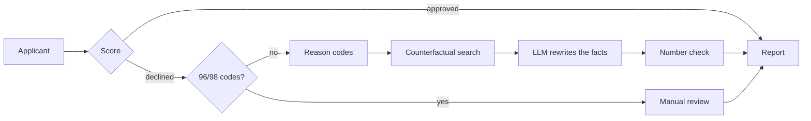

# Credit decisions with verified counterfactuals

A credit-risk model that does not just decline an applicant but explains why and, where one exists, finds a concrete change that would clear the lender's cutoff. Every number in the explanation is computed and checked. The language model only rephrases.


## What it does

1. Scores loan applicants with a transparent logistic model and a monotone gradient-boosted model.
2. For a declined applicant, lists the main reasons, separating what can change quickly (utilization, income, debt ratio) from what cannot (payment history).
3. Searches for the smallest realistic change that brings estimated default risk under the cutoff. A change counts only if **both models agree** it clears the cutoff.
4. Says plainly when no realistic change is enough, and routes files with ambiguous delinquency codes to manual review.
5. Has an LLM write the notice from pre-computed facts, then checks that every number in the text appears in those facts.

## Headline results

Dataset: Give Me Some Credit (150,000 borrowers, 6.7% default within two years). Cutoff: approve when predicted default probability is below 10%. At that cutoff 15.4% of the 30,000 test applicants are declined (4,615). The figures below use a random sample of 1,000 declined applicants, so each is good to about ±3 points.

| What can a declined applicant realistically do? | Logistic model alone | Both models must agree |
|---|---|---|
| One change is enough | 70.0% | **59.2%** |
| Needs a combination of changes | 4.1% | **4.8%** |
| No realistic path | 25.9% | **36.0%** |

- **Utilization is almost the only lever.** When one change is enough, it is a cut in revolving credit utilization of roughly a third. Raising income or lowering the debt ratio works alone for about 1% of applicants each.
- **Payment history explains the applicants with no path.** For 94% of them the largest fixed driver is a late-payment count (90+ days 45%, 30 to 59 days 35%, 60 to 89 days 15%). Age is the top fixed driver for under 1%.
- **The result is robust to the limits I assumed.** Across tighter and looser limits on what an applicant can change, 57% to 66% of declined applicants have a path both models agree on. Even with unrealistic changes (utilization to zero, income doubled, debt ratio to zero) the ceiling is 72%.
- **About 7% of declined applicants are near misses**, with a best case within 3 points above the cutoff. Their outcome is fragile.

| Model | Test AUROC | KS | Brier |
|---|---|---|---|
| Logistic regression | 0.8584 | 0.562 | 0.0508 |
| XGBoost, unconstrained | 0.8691 | 0.584 | 0.0488 |
| XGBoost, monotone (used) | 0.8678 | 0.579 | 0.0492 |

Both are well calibrated, so the probabilities can be read at face value.

## How it works



**Design decisions worth knowing about**

- **Monotone constraints.** The counterfactual search assumes that lowering utilization can only lower risk. An unconstrained XGBoost violated this for almost every applicant on a utilization sweep, which made some applicants look unfixable. Constraining it to be monotone in utilization, debt ratio, income and late counts costs 0.0013 AUROC and removes the problem. It also makes the floor check exact: the best case is at the corner of the allowed changes.
- **Consensus standard.** Counterfactuals first came from the logistic model alone. Scored by XGBoost, only 42% of them cleared the cutoff, because the two models disagree about how much a utilization cut helps, and the counterfactuals sat right on the boundary. The rule is now that the **higher** of the two models' risks must be under the cutoff.
- **Exact search where possible.** For a single lever, bisection gives the smallest sufficient change. DiCE (genetic search) is used only for the roughly 5% of cases where no single lever is enough.
- **Realistic limits.** Utilization no lower than 10%, income at most +30%, debt ratio at least halved. Higher income also lowers the debt ratio, assuming monthly debt payments stay fixed.
- **Reasons are lawful and honest.** Age is never shown as a reason. Fixed factors are labelled as not changeable quickly, and only when they are actually among the reasons.
- **Faithful explanations.** Option text is built in code with the numbers already formatted. The LLM rephrases it and a check flags any number in the output that is not in the facts.
- **Manual review.** The 96/98 values in the late-payment fields look like placeholders. A decision resting on them is referred to a person, and no advice is generated.

## Limitations

- **Association, not causation.** A counterfactual is what the model says would lower predicted risk. The data is observational, so reducing utilization is not guaranteed to cause lower default.
- **Consensus is conservative by design.** The maximum of two noisy estimates leans high, and both models are fit on the same data, so their agreement is a robustness check and not independent proof. The 36% with no path is therefore an upper estimate.
- **Age is a model input.** It is the second-strongest coefficient in the logistic model. It is excluded from the reasons shown, but in regulated lending it would need review, for example by refitting without it.
- **Assumed limits.** The bounds on what an applicant can change are my assumptions, and the sensitivity table shows how much they matter.
- **Old, public data.** Give Me Some Credit is a 2011 competition dataset, the 10% cutoff is a policy choice made for illustration, and the meaning of the 96/98 codes is not documented.
- **Not a compliant notice.** This is a research prototype. It is not a legally sufficient adverse action notice.
- **Sampling and randomness.** Results come from a 1,000-applicant sample with seed 42. DiCE's search and the LLM are not fully deterministic.

## Repository

```
credit_risk_clean.ipynb        full pipeline, run top to bottom
credit_dashboard.html          static dashboard (loads the JSON below, or embeds it)
credit_dashboard_data.json     38 example applicants plus summary statistics
README.md
docs/dashboard.png             screenshot
```

## Run it

```bash
pip install pandas numpy scikit-learn xgboost scipy matplotlib tqdm joblib dice-ml langgraph groq python-dotenv
```

1. Download `cs-training.csv` from the Give Me Some Credit Kaggle competition and put it next to the notebook.
2. Create a `.env` file containing `GROQ_API_KEY=...`.
3. Open `credit_risk_clean.ipynb` and use Restart and Run All. The evaluation takes several minutes.
4. Serve the folder (`python -m http.server`) and open `credit_dashboard.html`, or open `credit_dashboard_embedded.html` directly.

After a full run the notebook should show AUROC 0.8584 for the logistic model and 0.8678 for the monotone XGBoost.
